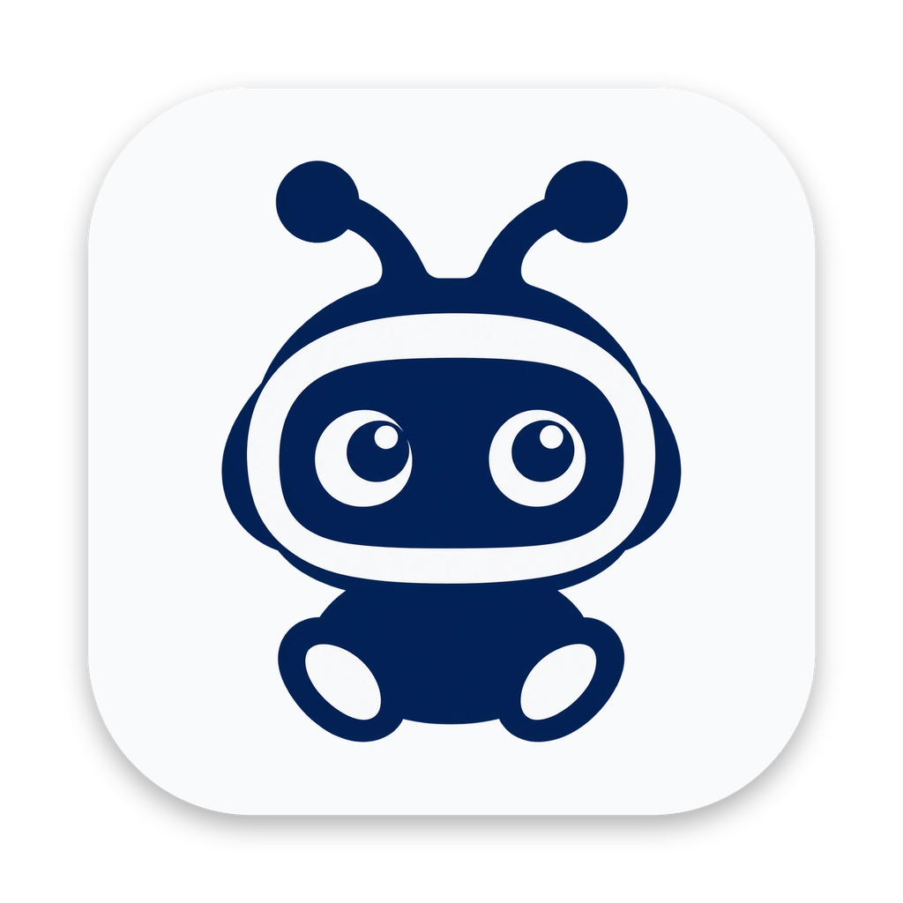

# Ret

A desktop app for running lots of coding agents at once, [Codex](https://github.com/openai/codex) and [Claude Code](https://claude.com/claude-code), across all your projects, without losing track of them.

**[getret.app](https://getret.app)** · [Download](https://github.com/ItsJustMeChris/ret/releases/latest)

Ret runs the official agents with your own sign-ins and settings, and keeps itself and Codex up to date.

## Run it

```bash
npm install
npm run dev        # run with hot reload
npm start          # build and launch
npm run dist       # Windows installer → release/
npm run dist:mac   # macOS dmg + zip → release/ (on a Mac)
```

## Layout

```
src/main/       Electron main process, the Codex and Claude Code engines, and remote access (remote/)
src/renderer/   the UI (demo/ is the website's in-browser version)
src/shared/     what both sides share, including the agent protocol
site/           getret.app
promo/          the launch video
```
